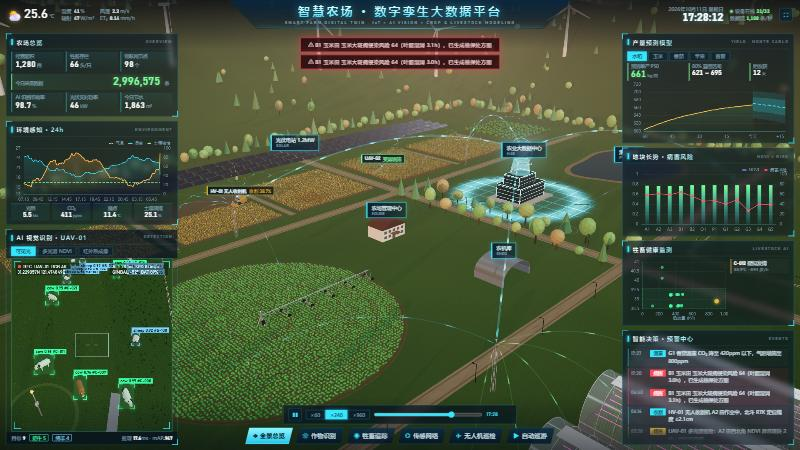

# 智慧农场 · 数字孪生大数据平台



基于 **Three.js + ECharts** 的智慧农场数字孪生演示系统：程序化 3D 建模整座农场，用物联网传感、无人机视觉、作物与牲畜机理模型驱动实时数据大屏。

## 快速开始

```bash
npm install
npm run dev
```

浏览器打开终端提示的地址（默认 http://localhost:5173）。Windows 下也可以直接双击 `启动.bat`。

生产构建：`npm run build`，产物在 `dist/`，可部署到任意静态服务器。

## 功能一览

| 模块 | 内容 |
| --- | --- |
| 3D 数字孪生 | 地形与山林、水稻/玉米/苜蓿/苹果/温室蔬菜（GPU 实例化，约 2 万株作物 + 2 万簇草，带风场摆动着色器）、牛舍、筒仓、智能温室（天窗随温控模型开合，夜间 LED 补光）、数据中心全息核心、光伏电站、风电、中心支轴喷灌机（缺水时自动启动并喷雾）、围栏与电子围栏 |
| 动物识别与追踪 | 22 头奶牛、16 只绵羊、28 只蛋鸡，各有行为状态机（采食/行走/卧息/饮水，夜间归舍），带 RFID 编号标签、健康光环和运动轨迹 |
| 无人机 | UAV-01 巡检（带云台相机实时画中画）、UAV-02 植保变量喷施、UAV-03 高空测绘 |
| AI 视觉识别 | 无人机画面叠加检测框：可见光 / 多光谱 NDVI / 红外热成像三种模式，识别牲畜个体、病斑、农机 |
| 无人收割机 | 北斗 RTK 弓字形全覆盖路径规划，割台经过处作物被实时割断 |
| 传感网络 | 27 个节点（土壤墒情、温室环境、气象站、水质、AI 摄像头、耳标基站、能源）→ 4 座 LoRaWAN 网关 → 数据中心，流光数据链路 |
| 昼夜循环 | 天空、太阳/月光、星空、萤火虫、路灯与温室补光随模拟时间变化 |

## 数据模型

位于 `src/data/`：

- **气象过程**：日变化 + Ornstein-Uhlenbeck 随机扰动（气温、云量、风、湿度）
- **FAO-56 Penman-Monteith 小时参考蒸散 ET₀**
- **土壤水量平衡**：ETc = Kc·ET₀，低于亏缺阈值时自动灌溉（中心支轴 / 滴灌 / 喷灌）
- **积温（GDD）驱动的 Logistic 产量形成模型**，作物长势取自 3D 场景中每株作物的健康度（NDVI）
- **蒙特卡洛集合产量预测**（n=400）：输出 P10–P90 / P25–P75 置信带与预计收获日
- **病害侵染风险**：叶面湿润时长 × Beta 温度响应函数 × 田间菌源量
- **温室环境控制**：一阶热平衡 + 天窗/风机/热泵/CO₂ 增施/补光策略
- **牲畜异常检测**：体温、活动量、反刍多指标稳健 Z 分数（中位数 + MAD），活动量来自 3D 场景中动物的实际运动；可识别疑似发热、发情、跛行、反刍减少
- **牛舍温湿指数 THI** 热应激评估

## 操作

- 鼠标左键旋转、右键平移、滚轮缩放；**单击**任意动物、传感器、地块、温室、无人机、收割机、建筑，查看详情卡片（含实时曲线、AI 研判和操作按钮）
- 底部模式：全景总览 / 作物识别（NDVI + 病斑定位）/ 牲畜追踪 / 传感网络 / 无人机巡检（跟随视角）/ 自动巡游（演示用）
- 时间轴：暂停、×60 / ×240 / ×960 倍速，拖动滑块切换一天中的时刻
- 快捷键：`1`–`6` 切换模式，`空格` 暂停，`H` 隐藏界面，`Esc` 关闭详情

## 说明

所有传感器读数、牲畜体征和视觉检测结果都是**模拟数据**：检测框由数字孪生场景中目标的真实位置投影生成，不是真实神经网络的推理结果。机理模型的公式与参数取自公开农学方法，接入真实数据源时替换 `src/data/simulator.js` 中的数据生成部分即可。

## 目录结构

```
src/
  main.js            入口：装配场景、模式切换、拾取、渲染循环
  layout.js          农场空间布局（地块、设施、传感器、病害热点）
  scene/             3D 建模（世界/地形/作物/设施/动物/传感器/无人机/收割机/粒子）
  data/              数据引擎与机理模型
  ui/                HUD、ECharts 图表、无人机视觉识别
```
